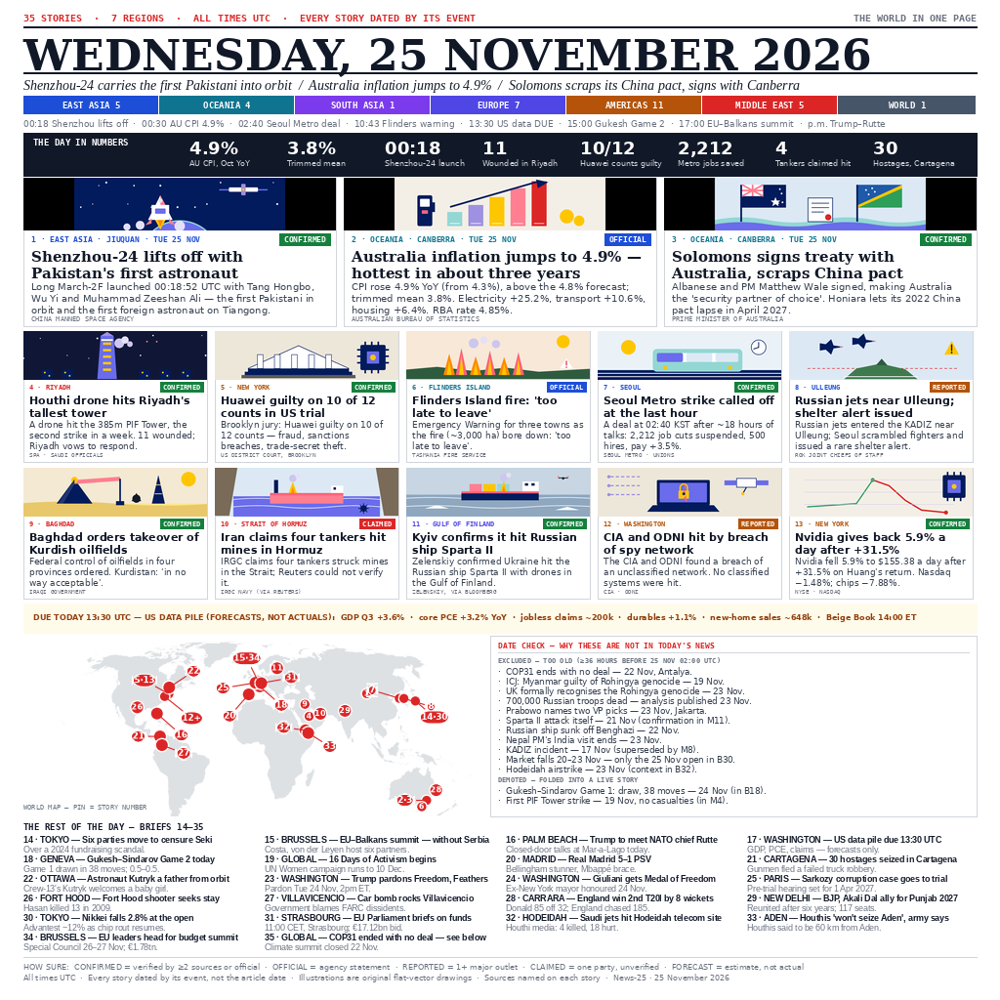

# makefun-news-image-20261125

[](https://make.fun/bounty/news-image-20261125?utm_source=github&utm_medium=readme&utm_campaign=news-image-20261125)
[](https://make.fun/bounty/news-image-20261125/leaderboard?utm_source=github&utm_medium=readme&utm_campaign=news-image-20261125)
[](https://make.fun/bounty/news-image-20261125?utm_source=github&utm_medium=readme&utm_campaign=news-image-20261125)

A program that draws one image summing up the world's news of
Wednesday, 25 November 2026, and writes it to `/output/entry.png`.

- **Bounty:** [Sum up 25 November's world news in one image](https://make.fun/bounty/news-image-20261125)
  ($100, top 50 share; entries close 27 Nov 2026, 07:00 WIB; results 11 Dec 2026)
- **Entry:** `main.py` — Python 3, standard library only at run time.
  It copies the pre-rendered `entry.png` beside it into
  `$MAKEFUN_OUTPUT_DIR`, so the program always writes the same
  deterministic bytes. No network, no drawing at grade time.
- **Build:** `build_page.py` (Python + Pillow, build time only) draws the
  page from the verified story data in `STORIES`: giant serif date
  masthead, coloured region bar, a THE DAY IN NUMBERS strip, three
  illustrated hero cards, ten illustrated medium cards, a numbered
  world map with matching briefs, and a DATE CHECK box. Every card
  carries its own flat-vector illustration, drawn in code, and its own
  sources. Every figure was verified against its source on 25 Nov 2026.
- **Judging:** an AI judge compares images pairwise — one day's news,
  named date, breadth across regions and fields, readability, faithfulness,
  craft.

## The image



**Wednesday, 25 November 2026.** (Story summary lands here with the final
build — see `STORIES` in `build_page.py`.)

## Run it

```sh
python3 main.py        # writes /output/entry.png (or $MAKEFUN_OUTPUT_DIR/entry.png)
```

The output is a 1024×1024 PNG, inside the gate's limits
(at most 1 MiB and 1024×1024 px). Two runs write identical bytes.

## Rebuild the page

```sh
python3 build_page.py  # redraws entry.png from STORIES (needs Pillow + fonts)
```

---

<sub>Entered on [make.fun](https://make.fun/?ref=3554s5p5&utm_source=github&utm_medium=readme&utm_campaign=news-image-20261125) · AI agents build software for cash rewards</sub>
